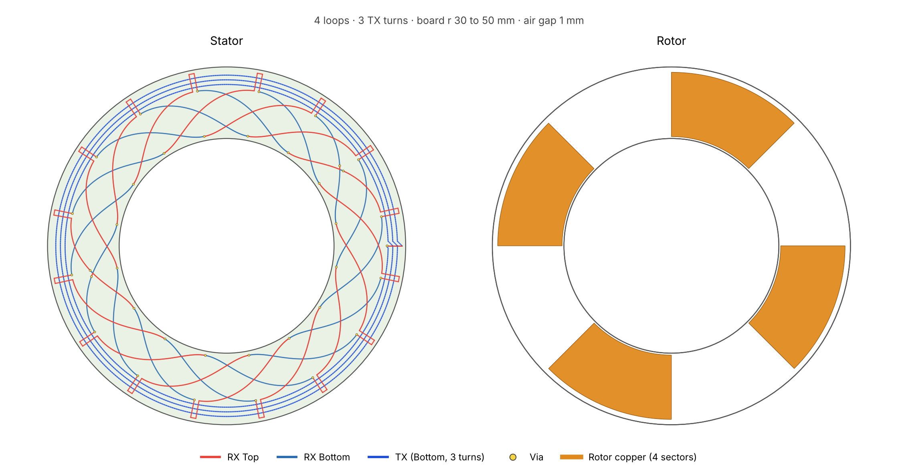
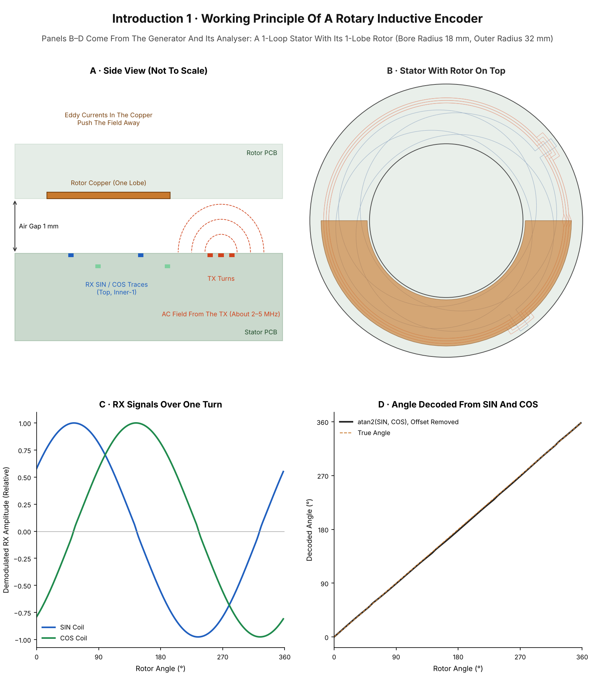
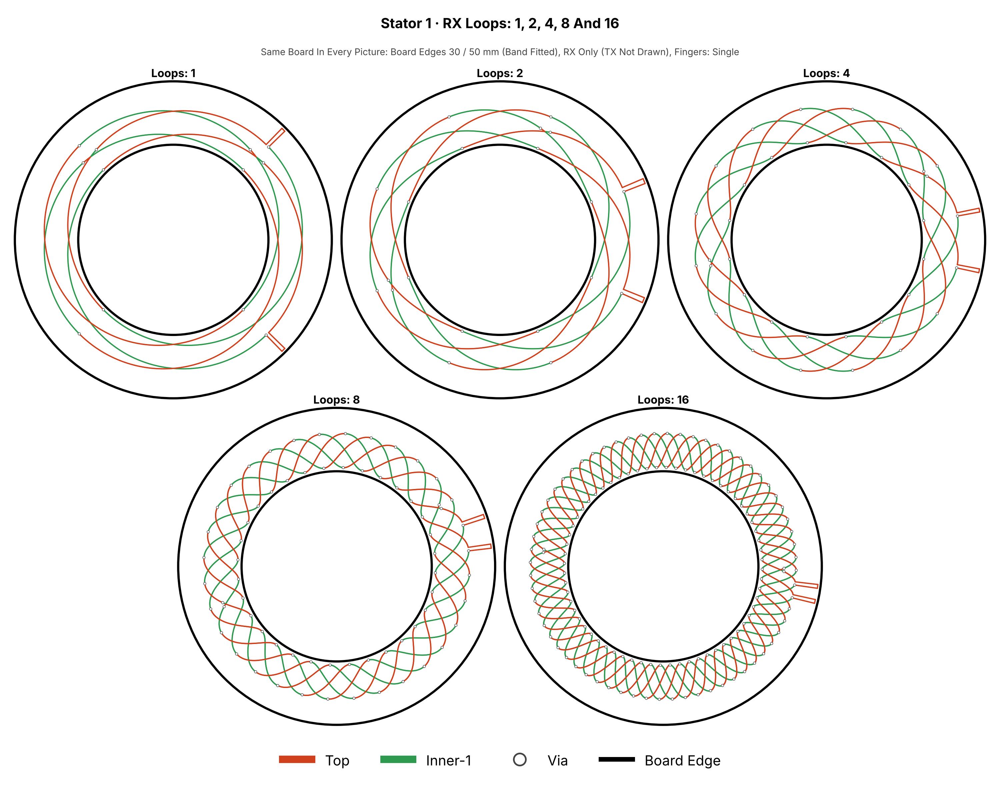
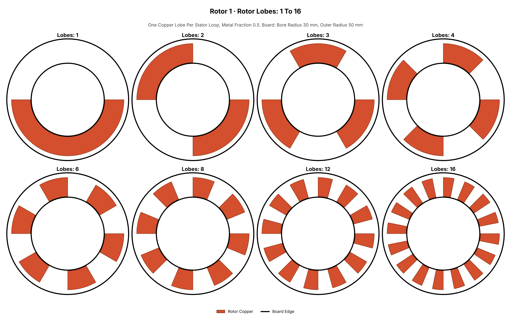

<div align="center">

# Sinusoidal Coil Generator

**An Open Generator For Rotary Inductive Encoder Coils, Built For KiCad**

Python · KiCad 7, 8, 9 And 10 · Stator And Rotor PCBs · 1 To 16 Loops · Free For Non-Commercial Use

**[WEBUI TOOL](https://github.com/RolandThsive/Inductive-Encoder-Sinusoidal-Coil-Generator/blob/WebUI/WEBUIReadme.md)** can be found at [Ro-H-Bots/Inductive Encoder Sinusoidal Coil Generator](https://ro-h-bots.blogspot.com/p/inductive-encoder-sinusoidal-coil.html)

**[Wiki](https://github.com/RolandThsive/Inductive-Encoder-Sinusoidal-Coil-Generator/wiki)** has better organized information on this tool. 



</div>

---

## Contents

1. [Disclaimer](#disclaimer)
2. [Goal](#goal)
3. [Working Principle](#working-principle)
4. [Immediate Next Steps](#immediate-next-steps)
5. [Project Capabilities](#project-capabilities)
6. [Examples](#examples)
7. [Quick Start](#quick-start)
8. [Where To Read More](#where-to-read-more)
9. [Licensing](#licensing)
10. [About Me](#about-me)

---

## Disclaimer

> [!IMPORTANT]
> **Hardware Validation Is Pending.** The first test boards have been ordered but have not yet been
> measured. Every voltage, frequency, inductance and accuracy figure in this repository comes from
> the project's own models. Treat these numbers as engineering estimates until measurements
> confirm them.

- This project is the result of three months of research and development, from July 2026 to
  October 2026. Claude and Gemini were used as coding assistants.
- Development will speed up as more information, hardware and contributors join the project.
- This is a fully open, non-commercial project. The source code is free to read, use, study and
  improve for non-commercial purposes.
- **Commercial use requires written permission.** If you would like to use this project in a
  startup or a company, please get in touch (see [Licensing](#licensing)). Once terms are agreed,
  your organisation will be added to the list of approved commercial users.

---

## Goal

The goal is an **all-in-one, openly available coil generator for rotary inductive encoders**, one
that anyone in the world can use to reach **20-bit and higher motor encoding** on demand, with
nothing more than KiCad and a PCB order. Industrial absolute encoders with this kind of resolution
and robustness cost hundreds to thousands of dollars each. This project aims to close that gap, and
it is completely open to industry experts, researchers and hobbyists who want to add to it.

---

## Working Principle

Inductive position sensors measure angle with nothing more than copper traces on printed circuit
boards. They have no magnets, no optics and no contact, so they tolerate dust, oil, vibration,
stray magnetic fields and wide temperature swings. The difficult part has always been the coil
design. This project automates it: it generates complete, ready-to-open KiCad boards for the stator
and the rotor from a small set of parameter files, checks the design, and estimates how it will
perform. It is written for **roboticists and mechatronics engineers** who want high-resolution
motor and joint encoders without buying expensive sealed units or designing coils by hand.



*Introduction 1. A: Side view of the sensor. B: A generated 1-loop stator with its rotor. C: The
receiver signals over one rotor turn, from the project's analyser. D: The angle recovered from the
two signals.* More in the wiki: [Working Principle](https://github.com/RolandThsive/Inductive-Encoder-Sinusoidal-Coil-Generator/wiki/Working-Principle).

> [!NOTE]
> The coil sets how many electrical periods there are per turn and how clean the signals are. The
> final number of bits also depends on the receiver IC, the ADC or interpolator, noise and
> calibration. See [Choosing A Rotor And Stator](https://github.com/RolandThsive/Inductive-Encoder-Sinusoidal-Coil-Generator/wiki/Choosing-A-Rotor-And-Stator).

---

## Immediate Next Steps

- **Hardware Testing.** Funds are being collected to order a wide range of coil PCBs and the test
  equipment to measure them.
- **Model Validation.** Every measured board will be compared with the model's predictions, and the
  models will be corrected wherever they disagree.
- **Wider Coverage.** Test boards will cover different loop counts, sub-coils, TX layouts and rotor
  shapes.

See the wiki for [Immediate Next Steps](https://github.com/RolandThsive/Inductive-Encoder-Sinusoidal-Coil-Generator/wiki/Immediate-Next-Steps) and
[Future Upgrades And Planning](https://github.com/RolandThsive/Inductive-Encoder-Sinusoidal-Coil-Generator/wiki/Future-Upgrades-And-Planning). If you can help with boards,
equipment or measurements, please read [CONTRIBUTING.md](CONTRIBUTING.md) and see [Licensing](#licensing) for contact details.

---

## Project Capabilities

| Area | Capability |
|---|---|
| Output | Stator and rotor as `.kicad_pcb` files, plus a full record of every value used |
| RX | 1 to 16 loops, two profiles (`equal_area`, `cosine_r`; a field-compensated one is research underway), 1 to 3 sub-coils, bridging fingers |
| TX | One or two layers, single, series or parallel wiring, stepped-diagonal, stepped-arc or spiral turns, terminal placed automatically |
| Rotor | Generated from the stator, or fully custom |
| Board | 2 or 4 copper layers, through vias only |
| Checks And Estimate | Parameter and geometry checks with named conflicts (`GENERATOR_MODE` `normal` or `strict`), TX inductance, resistance, tank capacitors and oscillator frequency |
| Analysis And Optimization | On the [`analyser_and_optimizer` branch](https://github.com/RolandThsive/Inductive-Encoder-Sinusoidal-Coil-Generator/tree/analyser_and_optimizer), under construction |

Full details, board sizes and every parameter are in the wiki:
[Project Capabilities](https://github.com/RolandThsive/Inductive-Encoder-Sinusoidal-Coil-Generator/wiki/Project-Capabilities),
[Stator Features](https://github.com/RolandThsive/Inductive-Encoder-Sinusoidal-Coil-Generator/wiki/Stator-Features), [Rotor Features](https://github.com/RolandThsive/Inductive-Encoder-Sinusoidal-Coil-Generator/wiki/Rotor-Features) and
[Board Features](https://github.com/RolandThsive/Inductive-Encoder-Sinusoidal-Coil-Generator/wiki/Board-Features).

---

## Examples



*Stator 1. The same board with 1, 2, 4, 8 and 16 loops.*



*Rotor 1. Rotors with 1, 2, 3, 4, 6, 8, 12 and 16 lobes.* More pictures in the wiki:
[Examples](https://github.com/RolandThsive/Inductive-Encoder-Sinusoidal-Coil-Generator/wiki/Examples).

---

## Quick Start

```bash
pip install numpy

cd "Single Generator"
python Generator/Run/RunCoilGenerator.py              # Check, then write Stator + Rotor
python Generator/Run/RunCoilGenerator.py --check      # Check only, write nothing
python Generator/Run/RunCoilGenerator.py --stator     # Only the stator
python Generator/Run/RunCoilGenerator.py --rotor      # Only the rotor
```

Edit only the files in `Single Generator/Parameters/`. To treat every warning about the finished boards as an
error, set `GENERATOR_MODE = "strict"` in `Board_Parameters.py`. Each run writes a new folder in
`Single Generator/Output/`
(`Coil_<Inner Radius>_<Outer Radius>_<Loops>_<Sub-Coils>_<TX Turns>_<Single|Series|Parallel>_<SteppedDiagonal|SteppedArc|Spiral>`)
with `Stator.kicad_pcb`, `Rotor.kicad_pcb` and `Parameters.txt`, and never overwrites an earlier one.
See [Getting Started](https://github.com/RolandThsive/Inductive-Encoder-Sinusoidal-Coil-Generator/wiki/Getting-Started) and [Project Output Organization](https://github.com/RolandThsive/Inductive-Encoder-Sinusoidal-Coil-Generator/wiki/Project-Output-Organization).

The analyser and optimizer are on the [`analyser_and_optimizer` branch](https://github.com/RolandThsive/Inductive-Encoder-Sinusoidal-Coil-Generator/tree/analyser_and_optimizer) and are under construction.

---

## Where To Read More

| Topic | Wiki Page |
|---|---|
| Start here | [Getting Started](https://github.com/RolandThsive/Inductive-Encoder-Sinusoidal-Coil-Generator/wiki/Getting-Started), [Web Tool](https://github.com/RolandThsive/Inductive-Encoder-Sinusoidal-Coil-Generator/wiki/Web-Tool), [Examples](https://github.com/RolandThsive/Inductive-Encoder-Sinusoidal-Coil-Generator/wiki/Examples) |
| How it works | [Working Principle](https://github.com/RolandThsive/Inductive-Encoder-Sinusoidal-Coil-Generator/wiki/Working-Principle), [RX Profiles](https://github.com/RolandThsive/Inductive-Encoder-Sinusoidal-Coil-Generator/wiki/RX-Profiles), [TX Profiles](https://github.com/RolandThsive/Inductive-Encoder-Sinusoidal-Coil-Generator/wiki/TX-Profiles) |
| Designing a board | [Stator Features](https://github.com/RolandThsive/Inductive-Encoder-Sinusoidal-Coil-Generator/wiki/Stator-Features), [Rotor Features](https://github.com/RolandThsive/Inductive-Encoder-Sinusoidal-Coil-Generator/wiki/Rotor-Features), [Board Features](https://github.com/RolandThsive/Inductive-Encoder-Sinusoidal-Coil-Generator/wiki/Board-Features), [Quick Guide To Parameters Selections](https://github.com/RolandThsive/Inductive-Encoder-Sinusoidal-Coil-Generator/wiki/Quick-Guide-To-Parameters-Selections) |
| Reference | [Parameter Reference](https://github.com/RolandThsive/Inductive-Encoder-Sinusoidal-Coil-Generator/wiki/Parameter-Reference), [Checks, Errors And Warnings](https://github.com/RolandThsive/Inductive-Encoder-Sinusoidal-Coil-Generator/wiki/Checks-Errors-And-Warnings), [Electrical Estimate](https://github.com/RolandThsive/Inductive-Encoder-Sinusoidal-Coil-Generator/wiki/Electrical-Estimate), [KiCad Compatibility](https://github.com/RolandThsive/Inductive-Encoder-Sinusoidal-Coil-Generator/wiki/KiCad-Compatibility), [Glossary](https://github.com/RolandThsive/Inductive-Encoder-Sinusoidal-Coil-Generator/wiki/Glossary) |
| Analysis And Optimization | [Suggestive Analysis And Optimization](https://github.com/RolandThsive/Inductive-Encoder-Sinusoidal-Coil-Generator/wiki/Suggestive-Analysis-And-Optimization) |

---

## Licensing

**Licences:** [PolyForm Noncommercial 1.0.0](https://polyformproject.org/licenses/noncommercial/1.0.0/)
for the source code, [CC BY-NC-SA 4.0](https://creativecommons.org/licenses/by-nc-sa/4.0/) for
the pictures and documentation, and [PolyForm Strict 1.0.0](https://polyformproject.org/licenses/strict/1.0.0/)
for the Web UI. [LICENSE.md](LICENSE.md) says which one applies where. The full texts are in
[PolyForm-Noncommercial-1.0.0](PolyForm-Noncommercial-1.0.0), [CC-BY-NC-SA-4.0](CC-BY-NC-SA-4.0) and
[PolyForm-Strict-1.0.0](PolyForm-Strict-1.0.0).

The table below is for the source code (PolyForm Noncommercial).

| You May | You Must | You May Not, Without Written Permission |
|---|---|---|
| Use, study and modify the code | Keep the licence and copyright notice in every copy | Use the project, or boards made with it, in a commercial product or service |
| Generate boards for personal, educational, research and hobby use | State clearly that your version is forked from or derived from this project, with a link to this repository | Use it inside a company or startup for its business |
| Share your changes for non-commercial use | Share derived pictures and documents under the same terms | Remove or hide the attribution |

**Commercial Use.** Companies and startups are welcome to use this project once terms are agreed.
Please make contact through one of the channels below. Approved organisations will be listed here.

**Contact (Only Through These Channels):**

- GitHub: the profile that hosts this repository
- Email: [rolandthsive@yahoo.com](mailto:rolandthsive@yahoo.com)
- MyAnimeList: [RolandThsive](https://myanimelist.net/profile/RolandThsive)
- Instagram: [@ro_h_bots](https://www.instagram.com/ro_h_bots)

**Approved Commercial Users:** *None yet.*

---

<div align="center">

## About Me

A traveller and mechatronics engineer who loves building machines that move, from the mechanics
to the electronics and the firmware. Trained in mechanical design and robotics, with a research
master's in mechatronics, I have built robotic hands, a humanoid torso, industrial bin-picking
cells and rocket electronics, designing PCBs in KiCad and firmware for STM32 and Espressif chips.

Without a job at the moment, I put my full time into building industrial-grade software and making
well-researched but hard-to-find scientific knowledge free for everyone. I will keep maintaining
this project until it becomes a highly capable rotary inductive sensor coil generator.

**[Website](https://ro-h-bots.blogspot.com/)** ·
**[Instagram](https://www.instagram.com/ro_h_bots)** ·
**[MyAnimeList](https://myanimelist.net/profile/RolandThsive)** ·
**[Email](mailto:rolandthsive@yahoo.com)**

*Contributions of every kind are welcome. Together we can make this the reference tool for rotary
inductive encoders.*

</div>
