<div align="center">

# Sinusoidal Coil Generator

**An Open Generator For Rotary Inductive Encoder Coils, Built For KiCad**

Python · KiCad 7, 8, 9 And 10 · Stator And Rotor PCBs · 1 To 16 Loops · Free For Non-Commercial Use

</div>

---

## Contents

1. [Disclaimer](#disclaimer)
2. [Introduction](#introduction)
3. [Goal](#goal)
4. [Immediate Next Steps](#immediate-next-steps)
5. [Project Capabilities](#project-capabilities)
6. [Examples](#examples)
7. [Stator Features](#stator-features)
8. [Rotor Features](#rotor-features)
9. [Board Features](#board-features)
10. [Suggestive Analysis And Optimization](#suggestive-analysis-and-optimization)
11. [Project Output Organization](#project-output-organization)
12. [KiCad Compatibility](#kicad-compatibility)
13. [Choosing A Rotor And Stator](#choosing-a-rotor-and-stator)
14. [Future Upgrades And Planning](#future-upgrades-and-planning)
15. [Licensing](#licensing)
16. [About Me](#about-me)

---

## Disclaimer

> [!IMPORTANT]
> **Hardware Validation Is Pending.** The first test boards have been ordered but have not yet been
> measured. Every voltage, frequency, inductance and accuracy figure in this repository comes from
> the project's own models. Treat these numbers as engineering estimates until measurements
> confirm them.

- This project is the result of three months of research and development, from July 2026 to
  October 2026. Claude and Gemini were used as coding assistants.
- Development will speed up as more information, hardware and contributors join the project.
- This is a fully open, non-commercial project. The source code is free to read, use, study and
  improve for non-commercial purposes.
- **Commercial use requires written permission.** If you would like to use this project in a
  startup or a company, please get in touch (see [Licensing](#licensing)). Once terms are agreed,
  your organisation will be added to the list of approved commercial users.

---

## Introduction

### Purpose Of This Project

Inductive position sensors measure angle with nothing more than copper traces on printed circuit
boards. They have no magnets, no optics and no contact, so they tolerate dust, oil, vibration,
stray magnetic fields and wide temperature swings. That is why they are used in automotive
throttle and pedal sensors, industrial servo drives and robot joints.

The difficult part has always been the coil design. The receiver coils must follow a precise
sinusoidal shape, the transmitter must be laid out without breaking that shape, and the rotor
target must match both. This project automates that work: it generates complete, ready-to-open
KiCad boards for the stator and the rotor from a small set of parameter files, checks the design,
and estimates how it will perform.

It is written for **roboticists and mechatronics engineers** who want high-resolution motor and
joint encoders without buying expensive sealed units or designing coils by hand.

### Working Principle


*Introduction 1. A: Side view of the sensor. B: A generated 1-loop stator with its rotor. C: The
receiver signals over one rotor turn, from the project's analyser. D: The angle recovered from the
two signals.*

1. **Excitation.** The transmitter coil (TX) on the stator carries an alternating current, usually
   between 2 and 5 MHz, set by an LC oscillator in the receiver IC.
2. **Target.** The rotor is a PCB with copper lobes. The TX field induces eddy currents in the
   copper, and these currents push the field away from the area each lobe covers.
3. **Reception.** Two receiver coils (RX) sit inside the TX ring. Each is a sinusoidal loop,
   wound so that it picks up no voltage from a uniform field. As the rotor turns, the uncovered
   area under each coil changes, so the induced voltage follows a sine (SIN coil) and a cosine
   (COS coil) of the rotor angle.
4. **Decoding.** The receiver IC (for example the Renesas IPS2550 or IPS2200) demodulates both
   signals. The angle within one electrical period is `atan2(SIN, COS)`.

The generator works with **four phases only: two SIN/COS pairs, each with a positive and a negative
half** (phases 0/2 form the SIN coil, phases 1/3 the COS coil). This differential arrangement
cancels the direct coupling from the TX and common-mode interference.

---

## Goal

The goal is an **all-in-one, openly available coil generator for rotary inductive encoders**, one
that anyone in the world can use to reach **20-bit and higher motor encoding** on demand, with
nothing more than KiCad and a PCB order.

Industrial absolute encoders with this kind of resolution and robustness cost hundreds to thousands
of dollars each. The physics behind them is well known; what has been missing is an open, reliable
way to design the coils. This project aims to close that gap.

There is a great deal of room for improvement, and the project is completely open to industry
experts, researchers and hobbyists who want to add to it. Every contribution, from a measurement on
a real board to a better field model, moves the project closer to being the reference tool for
rotary inductive encoders.

> [!NOTE]
> The coil sets how many electrical periods there are per turn and how clean the signals are. The
> final number of bits also depends on the receiver IC, the ADC or interpolator, noise and
> calibration. See [Choosing A Rotor And Stator](#choosing-a-rotor-and-stator).

---

## Immediate Next Steps

- **Hardware Testing.** Funds are being collected to order a wide range of coil PCBs and the test
  equipment to measure them.
- **Model Validation.** Every measured board will be compared with the analyser's predictions, and
  the models will be corrected wherever they disagree.
- **Wider Coverage.** Test boards will cover different loop counts, sub-coils, TX layouts and rotor
  shapes, so that the project becomes one of the most capable inductive rotary sensor coil
  generators available.

If you can help with boards, equipment or measurements, please see [Licensing](#licensing) for
contact details.

---

## Project Capabilities

| Area | Capability |
|---|---|
| Language | Pure Python 3 with numpy (matplotlib optional, for plots) |
| Output | Stator and rotor as `.kicad_pcb` files, plus a full record of every value used |
| RX Loops | 1 to 16 electrical periods per mechanical turn |
| RX Phases | Four phases only: SIN and COS pairs, each with a positive and a negative half |
| RX Profiles | `equal_area`, `cosine_r` (limaçon, as in the Renesas reference design), `field_compensated` |
| RX Sub-Coils | 1 to 3 per coil, mainly for miniature 1-loop coils |
| RX Fingers | Bridging fingers to break the coils out across the TX ring: all, single or none |
| TX Layers | Any one layer, or any two layers of a 4-layer board |
| TX Wiring | Series or parallel |
| TX Shape | Stepped or spiral turns, with an adjustable step angle |
| TX Break Style | Go-around (staggered) or stitched windows where a finger crosses the TX ring |
| Rotor | Generated from the stator, or fully custom |
| Board | 2 or 4 copper layers, through vias only, fixed or automatic board edges |
| Checks | Parameter rules, finished-geometry rules and the generator's own TX self-clearance check |
| Electrical Estimate | TX inductance, resistance, Q, tank capacitors, oscillator frequency and RX voltage against the IC limits |
| Analysis | Angle error, signal, harmonics and a tolerance window (air gap, eccentricity, tilt, etching) |
| Optimization | Searches profile, sub-coils, split, rotor metal fraction and rotor outer edge |

Each of these is shown with pictures in the sections below.

### Board Size Range

The table below gives the board sizes that build without any error or warning for 1, 4 and 16
loops. It was found by running the generator's own checks over a grid of board radii (1 mm steps)
with the default settings: 4 layers, series TX on Top + Inner-1 with 3 turns per layer, 0.6 mm
pitch, 0.6 / 0.3 mm vias, 0.2 mm clearance and IPS2550 limits.

| Loops | Smallest Outer Radius | Bore Radius On That Board | Bore Radius Range On Larger Boards | What Limits It |
|---|---|---|---|---|
| 1 | 12 mm | 1–3 mm | 1 mm up to (outer radius − 9 mm) | RX band width; on the smallest boards, the IPS2550 tank resistance |
| 4 | 13 mm | 2–3 mm | 2 mm up to (outer radius − 10 mm) | RX band width and tip vias |
| 16 | 26 mm | 12–14 mm | 12 mm up to (outer radius − 10 mm) | Tip vias crowd at small bore radii: a quarter loop needs about 1.3 mm of arc at the RX inner edge |

All radii are board edges (`INNER_EDGE_RADIUS_MM`, `OUTER_EDGE_RADIUS_MM`). The 1- and 4-loop rows
were checked in 1 mm steps and the 16-loop row in 2 mm steps, up to an outer radius of 30 mm; the
largest board built in this README has an outer radius of 56.5 mm. Smaller vias, fewer TX turns or
a finer pitch make smaller boards possible.

There is no upper limit in the generator itself. A larger board gives a wider RX band and a
stronger signal.

---

## Examples

*Coming soon. A curated set of complete example designs will be published here.*

---

## Stator Features

Every picture below is drawn directly from the `.kicad_pcb` files the generator wrote. Colours show
the net and the copper layer: blue for the SIN coil, green for the COS coil, and red (Top), orange
(Inner-1) and brown (Bottom) for the TX coil, with lighter shades of blue and green on the lower
layers. Close-ups are drawn to scale, with 0.2 mm traces and axes in millimetres from the board
centre.

### RX Coils

The RX coils are the measuring part of the sensor. The generator always builds **four phases: a SIN
pair and a COS pair, each with a positive and a negative half**. Every phase carries its rising
edges on one layer and its falling edges on the other, so the SIN and COS coils see the same air
gap at every angle.

#### Loops

`LOOPS` sets the number of electrical periods per mechanical turn, from 1 to 16. One loop gives a
true absolute 0–360° sensor. More loops divide the turn into finer periods for higher resolution.


*Stator 1. The same board with 1, 2, 4, 8 and 16 loops.*

#### Sub-Coils

Each RX coil can be split into 2 or 3 sub-coils, spread a few electrical degrees apart and wired in
series, as in the Renesas IPS2200 reference design. The split cancels chosen harmonics of the
signal (45° lowers the 3rd and 5th harmonics by about 59 %) and nearly doubles the signal. Sub-coils
are mainly useful on **miniature 1-loop coils**, where the RX band is small and harmonics matter
most.

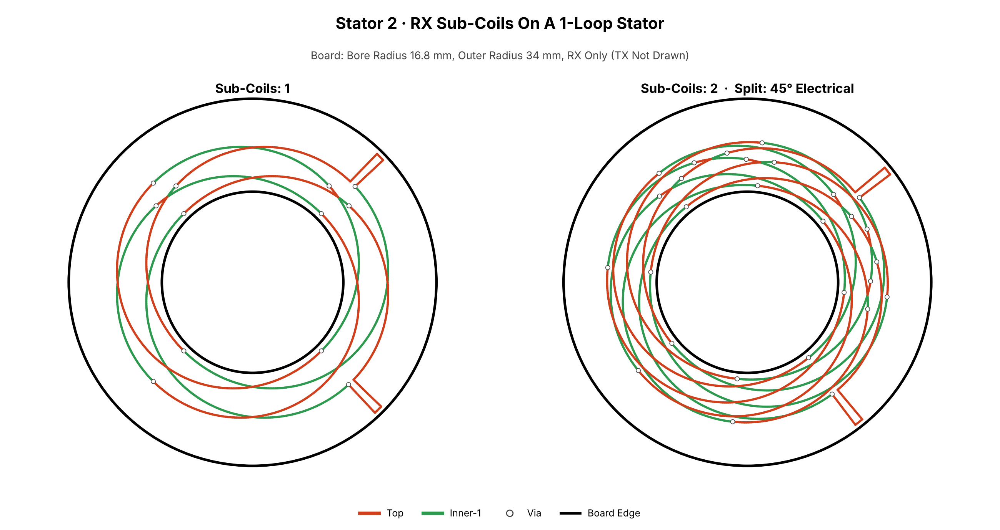

*Stator 2. A miniature 1-loop stator with 1 sub-coil and with 2 sub-coils split by 45°.*

#### Finger Styles

The RX coils lie inside the TX ring. Bridging fingers carry each coil out across the TX ring so it
can be broken out to the receiver IC. No terminals or pads are created; the coils are broken out by
hand where the user wants them.

| `RX_TABS` | Description |
|---|---|
| `all` | A finger at every outer tip of every phase (the original layout) |
| `single` | One finger per RX coil, next to the TX terminal |
| `none` | A plain RX band without fingers |

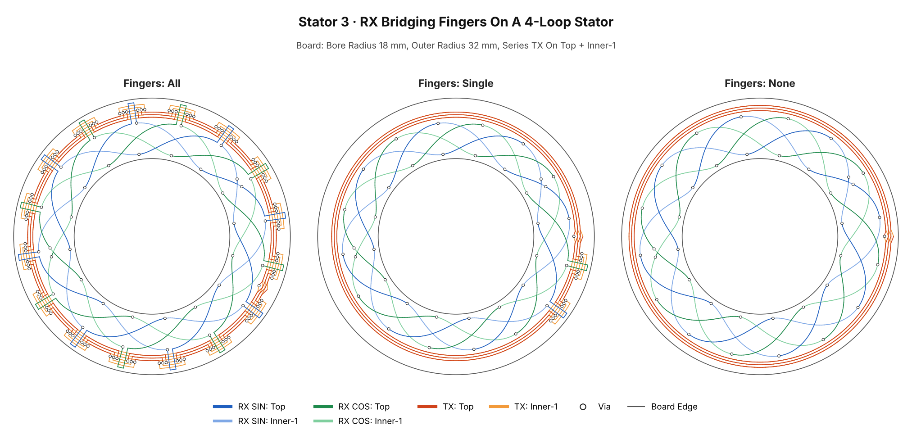

*Stator 3. A 4-loop stator with fingers set to All, Single and None. In the models, Single is as
accurate as None.*

### TX Coils

The TX coil excites the sensor. All pictures in this part use the same 4-loop RX coils so that only
the TX changes.

#### Number Of Turns

`TX_TURNS` sets the number of complete turns per TX layer. More turns raise the inductance and the
Q of the oscillator tank; fewer turns leave more room for the RX band.

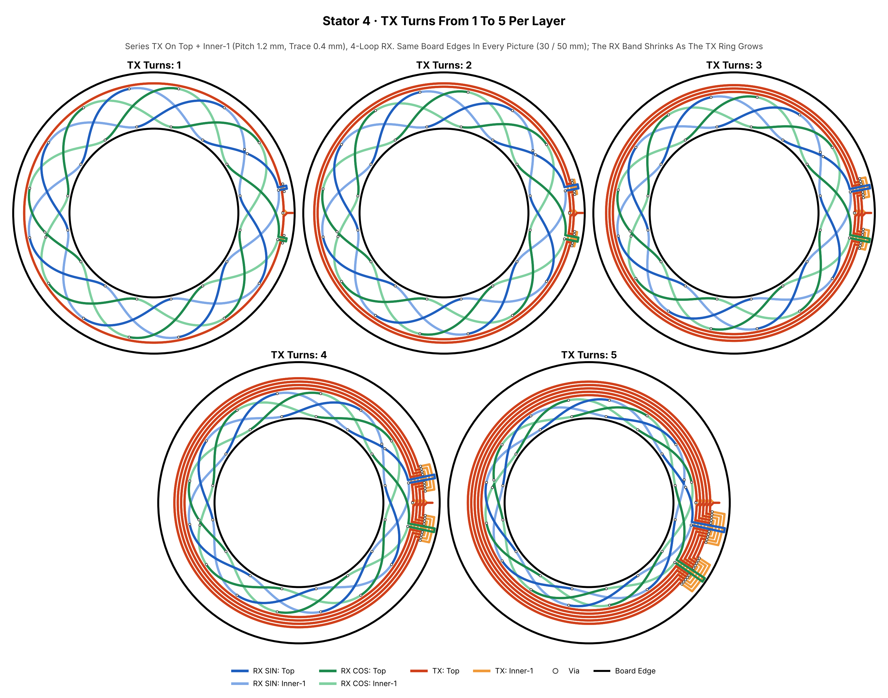

*Stator 4. 1 to 5 TX turns per layer. In this example 1 turn is flagged by the electrical check:
the tank resistance is close to the IPS2550 minimum.*

#### Series Versus Parallel

With two TX layers the turns can be wired in **series** (two spirals joined by a via at the inner
end, carrying current in the same direction) or in **parallel** (the same turns on both layers,
joined through vias). In the models a parallel TX gives about 6 % more signal and twice the Q of a
TX on Top alone.

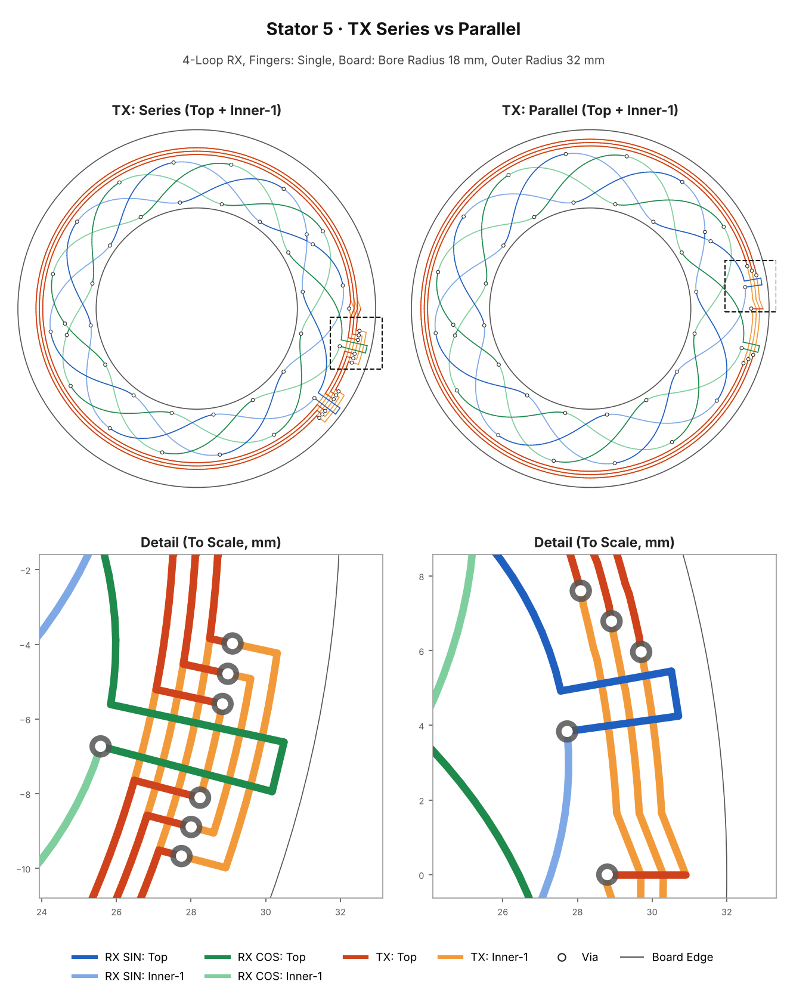

*Stator 5. Series and parallel TX on Top + Inner-1, with the detail around one RX finger.*

#### Series: Stepped Versus Spiral

**Stepped** turns are concentric circles joined by short steps near the terminal. **Spiral** turns
are one smooth Archimedean spiral with a constant gap, useful when the pitch is tight.

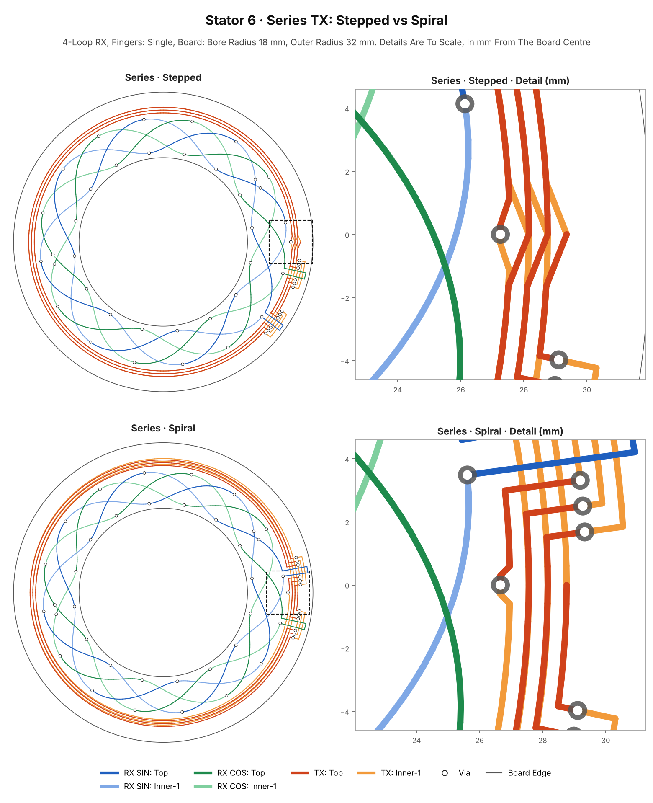

*Stator 6. Series TX with stepped and spiral turns, with the detail at the TX terminal.*

In a series spiral the two layers are mirror images. They coincide at the terminal and at 180°, and
are up to half a pitch apart at 90° and 270°. This is inherent: identical spirals would cancel each
other.

#### Parallel: Stepped Versus Spiral

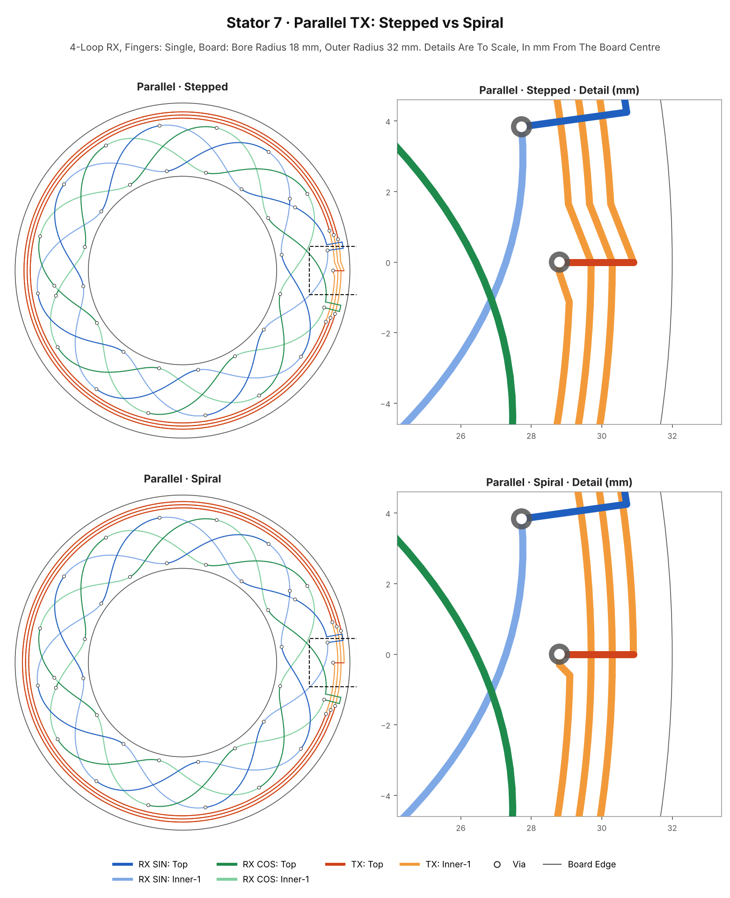

*Stator 7. Parallel TX with stepped and spiral turns. The two layers lie on top of each other, so
the Top turns are mostly hidden under Inner-1.*

#### Break Styles At The Fingers

Where an RX finger runs on a layer that also carries TX turns, the TX must make way for it:

| Style | Description |
|---|---|
| **Go-Around** (`staggered`) | Each turn stops before the finger in a staircase, runs out to a via, and a nested bracket on the other layer carries it around the finger (after Hoxha et al., *Sensors*, 2022). Used by every series TX. |
| **Stitched** (parallel only) | The turns on the finger's layer stop at a via on each side of the finger, and the other layer carries the current past it. |

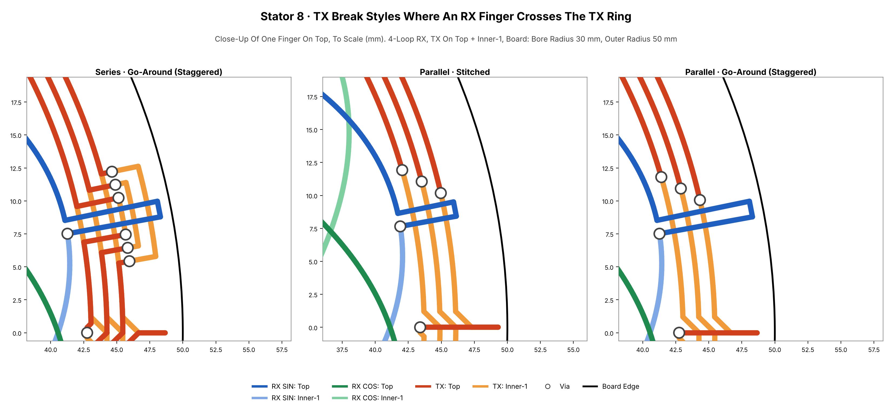

*Stator 8. Close-up of one finger: series go-around, parallel stitched and parallel go-around.*

#### Terminal Via Placement And Step Angle

All TX turns are one net, so KiCad's DRC cannot see a TX turn touching another TX turn. The
generator measures these gaps itself and warns.

`TX_INSIDE_VIA_DISTANCE_MM` moves the terminal via towards the centre, away from the next turn. At
0 mm (the original layout) the via comes too close to the neighbouring turn, and the generator
warns.

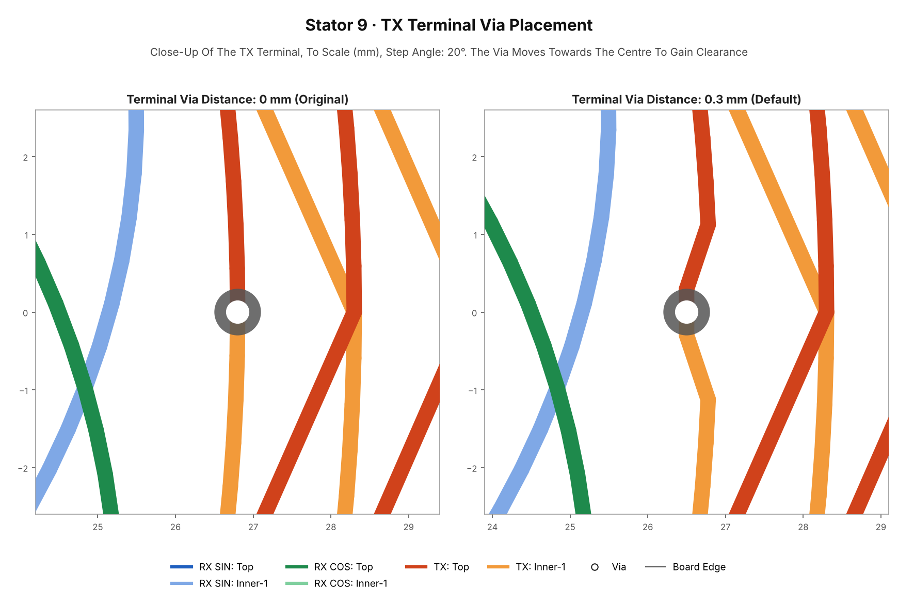

*Stator 9. Terminal via at 0 mm and at 0.3 mm (the default).*

`TX_STEPPED_ANGLE_DEG` sets the angle of the steps, measured from the turn: `auto` keeps the
original two-piece step, 90° steps straight out. Steep steps are staggered automatically to keep
the clearance.

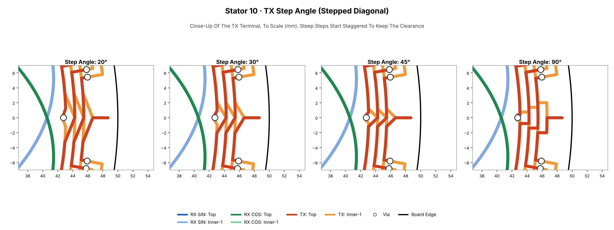

*Stator 10. Step angles of Auto, 20°, 45° and 90°.*

---

## Rotor Features

The rotor is a separate PCB with copper lobes on its face, mounted copper side towards the stator.
It is generated from the stator by default (`ROTOR_MODE = "according_to_stator"`), or drawn from
custom values.

### Lobes

The rotor always has one copper lobe for every stator loop.


*Rotor 1. Rotors with 1, 2, 3, 4, 6, 8, 12 and 16 lobes.*

A 1-lobe rotor is a half disc and is mechanically unbalanced; at high speed it needs a non-metal
counterweight.

### Edges And Metal Fraction

| Parameter | Effect |
|---|---|
| `ROTOR_AUTO_COVER_TX` | The copper runs over the TX turns, as in the Renesas reference designs (5–8 % more signal in the model) |
| `ROTOR_AUTO_TX_OVERHANG_MM` | How far the copper reaches past the outermost TX turn |
| `ROTOR_AUTO_EXTENSION_INNER_MM` | Where the copper ends on the inside, relative to the RX band |
| `ROTOR_AUTO_DUTY` | The metal fraction of each period (0.5 = half copper, half gap) |
| `ROTOR_AUTO_COPPER_LAYERS` | Which layers carry the copper |
| `ROTOR_SOLDER_MASK_EXPANSION_MM` | Solder mask opening over the copper |

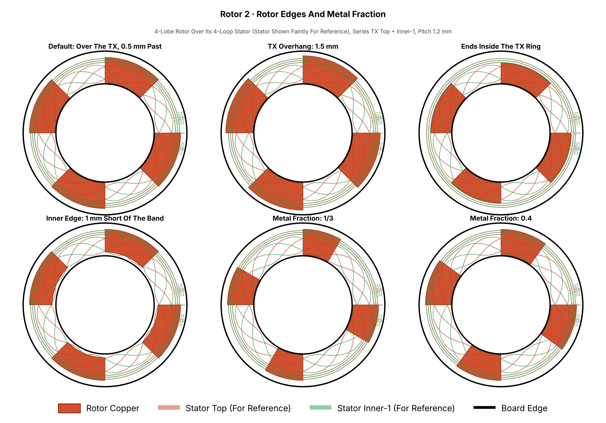

*Rotor 2. A 4-lobe rotor over its stator: the default, a larger TX overhang, copper ending inside
the TX ring, a shorter inner edge, and metal fractions of 1/3 and 0.4.*

The best metal fraction and outer edge depend on the coil. The optimizer searches them together.

---

## Board Features

| Feature | Description |
|---|---|
| Copper Layers | 2 or 4. On 4 layers the RX and TX layers are chosen freely |
| Vias | Through vias only, no blind or buried vias |
| Board Edges | Fixed bore and outer radius, or derived from the RX band |
| Clearance | Every via and trace is checked against `MIN_CLEARANCE_MM` |
| TX Self-Clearance | Checked by the generator, since KiCad's DRC cannot see it |
| Title Block | Filled in `Keyword: Value` style: TX, SIN/COS nets and phases, RX layers, radii, RX band |
| Page Size | Chosen automatically so the title block never overlaps the board |
| Silkscreen And Pads | None, on purpose: the coils are broken out by hand |

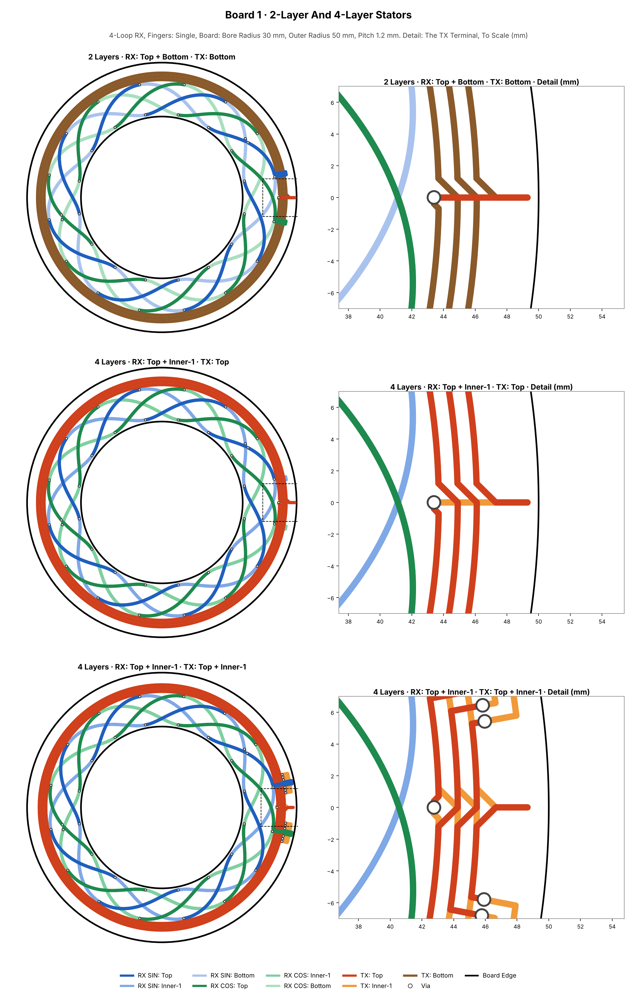

*Board 1. A 2-layer stator (RX on Top and Bottom, TX on Bottom), and 4-layer stators with the TX on
Top and on Top + Inner-1.*

Keep layers that carry no coil free of copper pours under the coil area: a plane there acts like an
extra target and weakens the signal.

---

## Suggestive Analysis And Optimization

The analyser and optimizer are optional. They never change a board or a parameter file.

- **AnalyzeCoil** builds the stator and rotor in memory and simulates both receiver coils while the
  rotor turns. It reports the signal, offset, SIN/COS match, harmonics and angle error, for the
  nominal design and for a tolerance window of air gap, rotor eccentricity, tilt and etching.
- **True-3D Copper Model.** Each coil is modelled from its real copper, layer by layer, using
  Biot–Savart. It agrees with exact Biot–Savart within 2–3.5 % rms.
- **Rotor Eddy-Current Model.** Each copper lobe is treated as a thin conductor carrying its own
  eddy current, so copper edges and copper over the TX are judged physically.
- **OptimizeCoil** searches the RX profile, sub-coils, split, rotor metal fraction and rotor outer
  edge, and ranks the results by the worst angle error over the tolerance window. It prints the
  parameter lines to change.

**Example.** The optimizer was run on a 1-loop stator (bore radius 18 mm, outer radius 32 mm) with
`OptimizeCoil.py --quick`. It suggested two sub-coils split by 50° and rotor copper that ends just
over the outermost TX turn:

| Design | Worst-Case Angle Error (Air Gap 1 ± 0.2 mm) | Relative Signal | RX Voltage (IPS2550, 6–11 Vpp TX) |
|---|---|---|---|
| Start: 1 sub-coil, `equal_area` profile | 0.66° electrical | 1.00 | 106–194 mVpp |
| Suggested: 2 sub-coils at 50°, copper overhang −0.25 mm | 0.18° electrical | 1.79 | 189–346 mVpp |

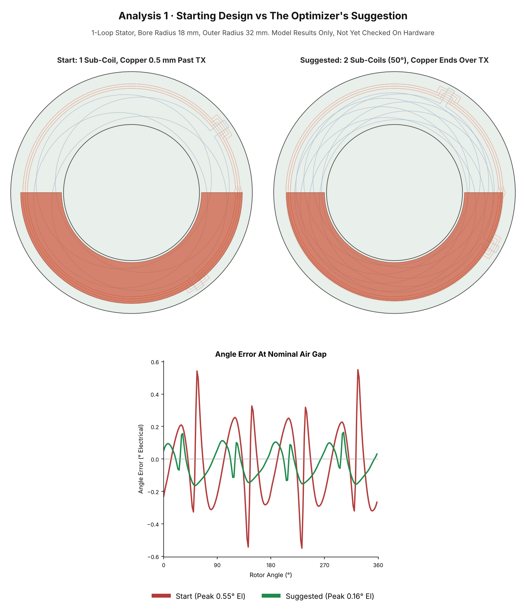

*Analysis 1. The starting design, the optimizer's suggestion, and their angle error over one turn at
the nominal air gap. Model results only.*

---

## Project Output Organization

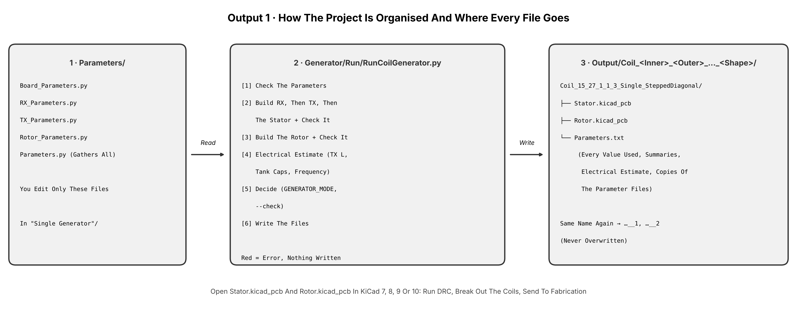

*Output 1. You edit only the parameter files. The generator checks them and writes one new folder
per run. The analyser and optimizer read the same parameters and never write boards.*

```text
Sinusoidal Coil Generator/
├── Parameters/                 Every setting: the only files you edit
│   ├── Board_Parameters.py       Output, PCB layers, vias, clearance, board outline, air gap, receiver IC
│   ├── RX_Parameters.py          Loops, radii, profile, sub-coils, layers, fingers
│   ├── TX_Parameters.py          Turns, pitch, shape, layers, series / parallel, break style
│   ├── Rotor_Parameters.py       The rotor (metal target)
│   ├── OptimizerParameters.py    What the optimizer compares
│   └── Parameters.py             Gathers the four board files (do not edit)
├── Generator/
│   ├── RunCoilGenerator.py       The program to run; the only one that writes files
│   ├── StatorGenerator.py        Stator geometry
│   ├── RotorGenerator.py         Rotor geometry
│   ├── TXLayout.py               Resolves the TX layout
│   ├── ParameterChecker.py       Rules for parameters and finished geometry
│   ├── OutputDirectoryManager.py Output folders and Parameters.txt
│   └── CoilElectrics.py          Electrical estimate
├── Analyser_And_Optimizer/
│   ├── AnalyzeCoil.py
│   ├── OptimizeCoil.py
│   ├── RealCopper.py
│   └── RotorEddyModel.py
└── Output/
    └── Coil_<Inner Radius>_<Outer Radius>_<Loops>_<Sub-Coils>_<TX Turns>_<Single|Series|Parallel>_<Stepped|Spiral>/
        ├── Stator.kicad_pcb
        ├── Rotor.kicad_pcb
        └── Parameters.txt
```

A run never overwrites anything: if a folder name already exists, `__1`, `__2` and so on are added.

### Quick Start

```bash
pip install numpy matplotlib

python Generator/RunCoilGenerator.py              # Check, then write Stator + Rotor
python Generator/RunCoilGenerator.py --check      # Check only, write nothing
python Generator/RunCoilGenerator.py --strict     # Treat warnings as errors
python Analyser_And_Optimizer/AnalyzeCoil.py      # Analyse the current parameters
python Analyser_And_Optimizer/OptimizeCoil.py --quick
```

Every program runs from any folder; it finds the other folders itself.

---

## KiCad Compatibility

| Item | Detail |
|---|---|
| File Format | KiCad 7 board format (`version 20221018`) |
| Opens In | KiCad 7, 8, 9 and 10. Newer versions convert the file when it is saved |
| Contents | Tracks, vias, board outline (`Edge.Cuts`), rotor copper polygons and solder mask openings |
| Libraries | None needed: no footprints, symbols or 3D models are referenced |
| Nets | `TX`, SIN (`2`) and COS (`1`), so KiCad's ratsnest and DRC understand the coils |
| Layers | `F.Cu`, `In1.Cu`, `In2.Cu`, `B.Cu` (Top, Inner-1, Inner-2, Bottom) |
| Title Block | Filled in automatically on every board |
| DRC | Clean apart from two expected `track_dangling` reports (the coils have no terminals yet) |

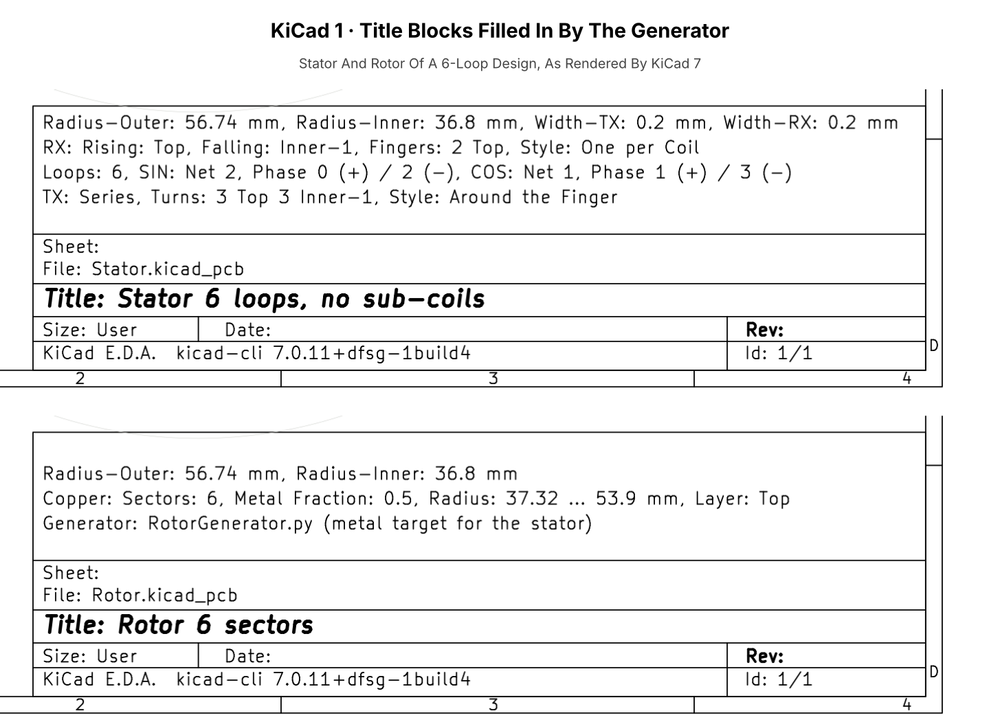

*KiCad 1. The title blocks of a generated stator and rotor, filled in `Keyword: Value` style.*

Because every TX turn is on the same net, KiCad's DRC cannot detect a TX turn touching another TX
turn. The generator runs this check itself and reports the smallest gap it found.

A KiCad plugin built on the same code is planned (see [Future Upgrades](#future-upgrades-and-planning)).

---

## Choosing A Rotor And Stator

- A **stator loop** is one full electrical period: one sine wave of the RX coils around the board.
- A **rotor lobe** is one copper sector on the rotor. The rotor always has as many lobes as the
  stator has loops.
- The receiver IC reports the angle within one electrical period. With N loops, that period covers
  360°/N of mechanical rotation.

| Loops / Lobes | Unique Range | Encoding Type | Extra Resolution From The Coil | Typical Use |
|---|---|---|---|---|
| 1 | 360° | True absolute over the full turn | None (reference) | Absolute joint angle, steering, knobs, output shafts |
| 2 | 180° | Absolute within half a turn | ×2 (+1 bit) | Mechanisms with less than 180° of travel |
| 3 | 120° | Absolute within a third of a turn | ×3 (+1.6 bits) | Limited-travel joints |
| 4 | 90° | Absolute within a quarter turn | ×4 (+2 bits) | Motor commutation for 4 pole-pair motors |
| 8 | 45° | Absolute within 45°, turns counted | ×8 (+3 bits) | Motor commutation and speed control |
| 16 | 22.5° | Absolute within 22.5°, turns counted | ×16 (+4 bits) | High-resolution motor encoders |

**Absolute 0–360° Encoding.** Use 1 loop. The output is unique over the whole turn from power-up.

**Higher Resolution.** Use more loops. Each loop repeats the full electrical range, so the
resolution per mechanical degree rises by the number of loops. The position is then unique only
within one period, and the turn count must be tracked from a homing or index position.

**Motor Commutation.** Match the loop count to the motor's pole-pair count, so that each electrical
period of the sensor lines up with one electrical period of the motor.

**Absolute And High Resolution Together.** Combine a 1-loop track with a multi-loop track
(vernier or coarse/fine). This needs two receiver ICs and is planned as the dual-IC version.

---

## Future Upgrades And Planning

| Upgrade | Description |
|---|---|
| **Desktop GUI** | A graphical interface in its own folder, built on top of the existing code without changing it. It will preview the coils as the parameters change and generate the KiCad boards. |
| **Web Tool** | A browser version on the my website that generates and downloads KiCad boards and footprints. |
| **Better Models From Real Hardware** | Measured boards will be used to correct the field, eddy-current and electrical models. Contributors with test equipment are very welcome. |
| **Custom IC Section** | A more robust analyser with a configurable IC section, so that any receiver IC can be described and the generated coils checked against it. |
| **Dual-IC Version** | Coils for two receiver ICs, giving redundancy and higher resolution (for example a 1-loop and a multi-loop track). |
| **KiCad Plugin** | Packaging the generator as a KiCad add-on through the Plugin and Content Manager. |

---

## Licensing

**Licence:** [PolyForm Noncommercial 1.0.0](https://polyformproject.org/licenses/noncommercial/1.0.0/)
for the source code, and [CC BY-NC-SA 4.0](https://creativecommons.org/licenses/by-nc-sa/4.0/) for
the pictures and documentation. The full text and the required notices are in [LICENSE.md](LICENSE.md).

| You May | You Must | You May Not, Without Written Permission |
|---|---|---|
| Use, study and modify the code | Keep the licence and copyright notice in every copy | Use the project, or boards made with it, in a commercial product or service |
| Generate boards for personal, educational, research and hobby use | State clearly that your version is forked from or derived from this project, with a link to this repository | Use it inside a company or startup for its business |
| Share your changes for non-commercial use | Share derived pictures and documents under the same terms | Remove or hide the attribution |

**Commercial Use.** Companies and startups are welcome to use this project once terms are agreed.
Please make contact through one of the channels below. Approved organisations will be listed here.

**Contact (Only Through These Channels):**

- GitHub: the profile that hosts this repository
- Email: [rolandthsive@yahoo.com](mailto:rolandthsive@yahoo.com)
- MyAnimeList: [RolandThsive](https://myanimelist.net/profile/RolandThsive)
- Instagram: [@ro_h_bots](https://www.instagram.com/ro_h_bots)

**Approved Commercial Users:** *None yet.*

---

<div align="center">

## About Me

A traveller and mechatronics engineer who loves building machines that move, from the mechanics
to the electronics and the firmware. Trained in mechanical design and robotics, with a research
master's in mechatronics, I have built robotic hands, a humanoid torso, industrial bin-picking
cells and rocket electronics, designing PCBs in KiCad and firmware for STM32 and Espressif chips.

Without a job at the moment, I put my full time into building industrial-grade software and making
well-researched but hard-to-find scientific knowledge free for everyone. I will keep maintaining
this project until it becomes a highly capable rotary inductive sensor coil generator. Meanwhile I
am gathering data on the encoders sold today at very high prices and collecting the research
papers behind them.

**[Website](https://ro-h-bots.blogspot.com/)** ·
**[Instagram](https://www.instagram.com/ro_h_bots)** ·
**[MyAnimeList](https://myanimelist.net/profile/RolandThsive)** ·
**[Email](mailto:rolandthsive@yahoo.com)**

*Contributions of every kind are welcome. Together we can make this the reference tool for rotary
inductive encoders.*

</div>
