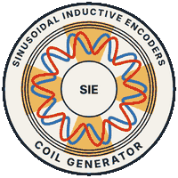
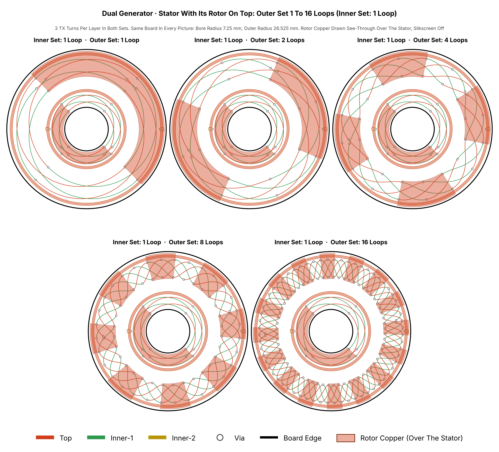

<div align="center">



# Sinusoidal Coil Generator

**An open generator for rotary inductive encoder coils, built for KiCad.**
Set the parameters, get a stator and a rotor as KiCad boards, checked and with an estimate of how they will perform.

[](https://ro-h-bots.blogspot.com/p/inductive-encoder-sinusoidal-coil.html)
[](https://github.com/RolandThsive/Inductive-Encoder-Sinusoidal-Coil-Generator/wiki)
[](https://github.com/RolandThsive/Inductive-Encoder-Sinusoidal-Coil-Generator/wiki/Examples)

[](MILESTONES.md)
[](CONTRIBUTING.md)
[](LICENSE.md)


Inductive position sensors measure angle with nothing more than copper traces on printed circuit boards. They have no magnets, no optics and no contact, so they tolerate dust, oil, vibration, stray magnetic fields and wide temperature swings. The difficult part has always been the coil design. This project automates it: it generates complete, ready-to-open KiCad boards for the stator and the rotor from a small set of parameter files, checks the design, and estimates how it will perform. It is written for roboticists and mechatronics engineers who want high-resolution motor and joint encoders without buying expensive sealed units or designing coils by hand.


*A generated stator (left) and rotor (right): 4 loops, 3 TX turns, board radius 30 to 50 mm.*

</div>


> [!IMPORTANT]
> **Hardware validation is pending.** The first test boards have been ordered but have not yet been measured.
> Every voltage, frequency, inductance and accuracy figure in this repository comes from the project's own models.
> Treat these numbers as engineering estimates until measurements confirm them.

## Documentation

| I want to | Read |
|---|---|
| Start | [Getting Started](https://github.com/RolandThsive/Inductive-Encoder-Sinusoidal-Coil-Generator/wiki/Getting-Started), [Web Tool](https://github.com/RolandThsive/Inductive-Encoder-Sinusoidal-Coil-Generator/wiki/Web-Tool), [Examples](https://github.com/RolandThsive/Inductive-Encoder-Sinusoidal-Coil-Generator/wiki/Examples) |
| Understand it | [Working Principle](https://github.com/RolandThsive/Inductive-Encoder-Sinusoidal-Coil-Generator/wiki/Working-Principle), [RX Profiles](https://github.com/RolandThsive/Inductive-Encoder-Sinusoidal-Coil-Generator/wiki/RX-Profiles), [TX Profiles](https://github.com/RolandThsive/Inductive-Encoder-Sinusoidal-Coil-Generator/wiki/TX-Profiles) |
| Design a board | [Choosing A Rotor And Stator](https://github.com/RolandThsive/Inductive-Encoder-Sinusoidal-Coil-Generator/wiki/Choosing-A-Rotor-And-Stator), [Quick Guide To Parameters Selections](https://github.com/RolandThsive/Inductive-Encoder-Sinusoidal-Coil-Generator/wiki/Quick-Guide-To-Parameters-Selections), [Stator Features](https://github.com/RolandThsive/Inductive-Encoder-Sinusoidal-Coil-Generator/wiki/Stator-Features), [Rotor Features](https://github.com/RolandThsive/Inductive-Encoder-Sinusoidal-Coil-Generator/wiki/Rotor-Features), [Board Features](https://github.com/RolandThsive/Inductive-Encoder-Sinusoidal-Coil-Generator/wiki/Board-Features), [Silkscreen](https://github.com/RolandThsive/Inductive-Encoder-Sinusoidal-Coil-Generator/wiki/Silkscreen) |
| Design a dual board | [Stator Features](https://github.com/RolandThsive/Inductive-Encoder-Sinusoidal-Coil-Generator/wiki/Stator-Features-Dual-Generator), [Rotor Features](https://github.com/RolandThsive/Inductive-Encoder-Sinusoidal-Coil-Generator/wiki/Rotor-Features-Dual-Generator), [Board Features](https://github.com/RolandThsive/Inductive-Encoder-Sinusoidal-Coil-Generator/wiki/Board-Features-Dual-Generator), [Silkscreen](https://github.com/RolandThsive/Inductive-Encoder-Sinusoidal-Coil-Generator/wiki/Silkscreen-Dual-Generator), [Quick Guide To Parameters Selections](https://github.com/RolandThsive/Inductive-Encoder-Sinusoidal-Coil-Generator/wiki/Quick-Guide-To-Parameters-Selections-Dual-Generator) |
| Look something up | [Parameter Reference Single Generator](https://github.com/RolandThsive/Inductive-Encoder-Sinusoidal-Coil-Generator/wiki/Parameter-Reference-Single-Generator), [Parameter Reference Dual Generator](https://github.com/RolandThsive/Inductive-Encoder-Sinusoidal-Coil-Generator/wiki/Parameter-Reference-Dual-Generator), [Checks, Errors And Warnings](https://github.com/RolandThsive/Inductive-Encoder-Sinusoidal-Coil-Generator/wiki/Checks-Errors-And-Warnings), [Electrical Estimate](https://github.com/RolandThsive/Inductive-Encoder-Sinusoidal-Coil-Generator/wiki/Electrical-Estimate), [KiCad Compatibility](https://github.com/RolandThsive/Inductive-Encoder-Sinusoidal-Coil-Generator/wiki/KiCad-Compatibility), [Regression Testing](https://github.com/RolandThsive/Inductive-Encoder-Sinusoidal-Coil-Generator/wiki/Regression-Testing), [Glossary](https://github.com/RolandThsive/Inductive-Encoder-Sinusoidal-Coil-Generator/wiki/Glossary) |
| See what is next | [Immediate Next Steps](https://github.com/RolandThsive/Inductive-Encoder-Sinusoidal-Coil-Generator/wiki/Immediate-Next-Steps), [Future Upgrades And Planning](https://github.com/RolandThsive/Inductive-Encoder-Sinusoidal-Coil-Generator/wiki/Future-Upgrades-And-Planning), [Suggestive Analysis And Optimization](https://github.com/RolandThsive/Inductive-Encoder-Sinusoidal-Coil-Generator/wiki/Suggestive-Analysis-And-Optimization), [MILESTONES.md](MILESTONES.md) |

## Quick Start

```bash
pip install numpy

cd "Single Generator"
python Generator/Run/RunCoilGenerator.py              # Check, then write Stator + Rotor
python Generator/Run/RunCoilGenerator.py --check      # Check only, write nothing
python Generator/Run/RunCoilGenerator.py --stator     # Only the stator
python Generator/Run/RunCoilGenerator.py --rotor      # Only the rotor
```

Edit only the files in `Single Generator/Parameters/`. Each run writes a new folder in `Single Generator/Output/`
with `Stator.kicad_pcb`, `Rotor.kicad_pcb` and `Parameters.txt`, and never overwrites an earlier one. Prefer a
browser? Use the [Web Tool](https://ro-h-bots.blogspot.com/p/inductive-encoder-sinusoidal-coil.html). Full
walk-through: [Getting Started](https://github.com/RolandThsive/Inductive-Encoder-Sinusoidal-Coil-Generator/wiki/Getting-Started).

## What Works

- **Stator:** 1 to 16 loops, two RX profiles, 1 to 3 sub-coils, bridging fingers; TX on one or two layers, single,
  series or parallel, with stepped-diagonal, stepped-arc or spiral turns; the TX terminal is placed automatically.
- **Rotor:** generated from the stator, or fully custom.
- **Board:** 2 or 4 copper layers; through vias, or blind vias on 4-layer boards.
- **Checks and estimate:** geometry and parameter checks that name the conflict (`normal` or `strict` mode), TX
  inductance, resistance, tank capacitors and oscillator frequency against your receiver IC's limits.
- **Dual Generator:** two coil sets on one stator with a two-ring rotor disc (`Dual Generator/`).
- **Regression tests:** both generators are tested on every pull request.
- **Analyser and optimizer:** under construction on the
  [`analyser_and_optimizer` branch](https://github.com/RolandThsive/Inductive-Encoder-Sinusoidal-Coil-Generator/tree/analyser_and_optimizer).

Every parameter and every board size is in the wiki:
[Project Capabilities](https://github.com/RolandThsive/Inductive-Encoder-Sinusoidal-Coil-Generator/wiki/Project-Capabilities),
[Stator](https://github.com/RolandThsive/Inductive-Encoder-Sinusoidal-Coil-Generator/wiki/Stator-Features),
[Rotor](https://github.com/RolandThsive/Inductive-Encoder-Sinusoidal-Coil-Generator/wiki/Rotor-Features) and
[Board](https://github.com/RolandThsive/Inductive-Encoder-Sinusoidal-Coil-Generator/wiki/Board-Features) features.



*The Dual Generator: one stator with two coil sets and its rotor on top. The outer set has 1, 2, 4, 8 and 16 loops, the inner set 1 loop.*

## Status And Next Steps

- **Hardware testing.** Funds are being collected to order a wide range of coil PCBs and the test equipment to
  measure them.
- **Model validation.** Every measured board will be compared with the model's predictions, and the models will be
  corrected wherever they disagree.
- **Wider coverage.** Test boards will cover different loop counts, sub-coils, TX layouts and rotor shapes.

## Contributing

Help with boards, equipment, measurements, code and documentation is welcome. Read
[CONTRIBUTING.md](CONTRIBUTING.md) to see how to get involved.

## Licensing

This repository is **open for research use** and free for non-commercial use: researchers, students, hobbyists and
curious engineers are welcome. Three licenses apply: [PolyForm Noncommercial 1.0.0](PolyForm-Noncommercial-1.0.0)
for the source code, [CC BY-NC-SA 4.0](CC-BY-NC-SA-4.0) for the pictures and documentation, and
[PolyForm Strict 1.0.0](PolyForm-Strict-1.0.0) for the Web UI. [LICENSE.md](LICENSE.md) says which one applies where
and what each allows.

**Commercial use requires written permission.** Companies and startups are welcome: you pay 0.2% of the net sale
price of every unit sold and every paid service, reported in the public [LEDGER.md](LEDGER.md). The full terms are in
[LICENSE.md](LICENSE.md#commercial-use). Approved organisations will be listed here.

**Thanks to our approved commercial users:** *None yet.*

**Contact (only through these channels):**
[Email](mailto:rolandthsive@yahoo.com) ·
[GitHub](https://github.com/RolandThsive) ·
[MyAnimeList](https://myanimelist.net/profile/RolandThsive) ·
[Instagram](https://www.instagram.com/ro_h_bots)

## Every Commercial Payment Goes Back Into The Project

> [!IMPORTANT]
> **100% ON RECORD. 100% INVESTED BACK. 100% DISCLOSED.**

Any money accepted from commercial users goes back into this project in full, and all of it is on record. Nothing is
taken out as profit. Every payment, expense and donation is in the public [LEDGER.md](LEDGER.md), with proof. The fee
stops when every milestone in [MILESTONES.md](MILESTONES.md) is done, and the license then becomes the same as the GPL,
truly open source.

<details>
<summary>The full pledge</summary>

**Any money I accept from commercial users here will be invested back into this project in full, 100%, and all of it
will be on record.** This is how the project works like a non-profit, in an extreme way: nothing is taken out as
profit.

- **100% invested back.** Boards, test equipment, measurements, research and development of this project.
- **Leftovers are donated.** Whatever is left over goes to a fund that supports innovation worldwide, chosen
  together by me and the paying company.
- **100% on record.** Every payment, every expense and every donation is written in the public
  [LEDGER.md](LEDGER.md) of this repository, with proof.
- **Completely disclosed.** Everyone who can see this repository can see the ledger. Nothing is hidden.
- **Non-profit, exclusively.** Every fee, investment and contribution is used only for the equipment and services
  used to build this project, and for nothing else. No profit means no profit.
- **No opaque portions.** The transparency is absolute. Every cent that comes in and every cent that goes out is in
  the ledger, with proof. Money that is not in the ledger does not exist for this project, and none is accepted outside
  it, even a single cent. To protect confidentiality, a contributor's name may be struck out, but never the receipt
  or the transaction details.

This is an open project, so I expect it to be **open to the highest degree** and **completely functioning**, with a
**stern warning**. I went through a bunch of licenses and saw how things work in the "Open Source Stuff". **That stuff
is broken.** And I see that there is **very little goodwill** in this world towards the people who are willing to free
stuff.

**Here is what I came up with. So, in sassy boy Seth's freedom intonation:**

Here's the deal. This is **completely free** (as in freedom-units free), **except if you are a commercial user**. You
have to **pay** to make this research even better. Yes, you. **Pay up.** That's called improving the stuff you used.
Tax stuff. Everything has it. This too has it. It's **completely non-profit**. There is **no "commercialization",
absolutely none.** **0.2%** is the maximum allowable transaction per unit sale, and it stops after the fulfillment of
**all the milestones**.

There is **no restriction on anything here** unless you are **not contributing back** appropriately. Especially no
restriction just to profit from it. Again: **profit bad, investment for making this project good.** That will stop
when this generator reaches its final stage, and a new license will apply, **the same as the GPL** - **truly open source**.

</details>

---

<div align="center">

## About Me

A traveller and mechatronics engineer who loves building machines that move, from the mechanics to the electronics
and the firmware. Trained in mechanical design and robotics, with a research master's in mechatronics, I have built
robotic hands, a humanoid torso, industrial bin-picking cells and rocket electronics, designing PCBs in KiCad and
firmware for STM32 and Espressif chips.

I put my full time into building industrial-grade software and making well-researched but hard-to-find scientific
knowledge free for everyone. I will keep maintaining this project until it becomes a highly capable rotary inductive
sensor coil generator.

**[Website](https://ro-h-bots.blogspot.com/)** ·
**[Instagram](https://www.instagram.com/ro_h_bots)** ·
**[MyAnimeList](https://myanimelist.net/profile/RolandThsive)** ·
**[Email](mailto:rolandthsive@yahoo.com)**

*Contributions of every kind are welcome. Together we can make this the reference tool for rotary inductive encoders.*

</div>
